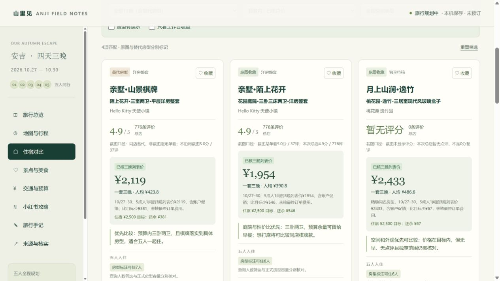

# 安吉五人旅游工作台

一个可直接部署的中文静态旅行工作台，把四天行程、地图、民宿对比、交通、预算与核实记录放在同一页面。当前版本为一次具体旅行的研究快照，可编辑源码继续调整。

**[打开线上工作台](https://anji-october-five-2026.mintyluck6.chatgpt.site/)**



## 本次旅行设定

- 日期：2026年10月27日（周二）至10月30日（周五），五人、四天三晚。
- 交通：周二下午从上海虹桥乘高铁到安吉，在安吉当地租车；计划车型为一嗨丰田卡罗拉，具体订单尚需确认。
- 住宿：希望五人入住一个独立空间，优先两卧或三卧；三晚合计目标 **¥2,500**，即每人三晚 **¥500**。
- 全程默认规划预算：**¥6,880 / 五人**，人均 **¥1,376**。比早期¥6,000目标多¥880；这些是可调整的预算额度，不是已支付费用。

## 可以做什么

- **旅行总览**：四天安排、预算摘要、天气快照与出发前待办。
- **地图与行程**：切换日期及雨天方案，从地点清单补充一站，调整自添地点的顺序与备注，打印当天行程。
- **住宿对比**：默认展示原收藏截图中的8项，切换后可比较全部11项（含3个替代房型）；按预算、空间类型、房型娱乐设施及工作台收藏筛选。
- **报价试算**：分别标记“已核三晚列表价”“按单晚估算”“三晚待核”；支持自填金额、恢复平台参考值、替换住宿预算和恢复上次预算。
- **景点、美食与攻略**：检索地点、收藏候选，阅读小红书攻略摘要及其来源链接。
- **旅行手记**：保存备注、确认进度、收藏和预算，导出或导入JSON旅行记录。

## 本地运行

使用Python 3，在仓库根目录执行：

```bash
python -m http.server 8000 --directory dist
```

然后打开 **http://localhost:8000**。

也可以直接用浏览器打开 `dist/index.html`；建议使用本地服务器，以获得更稳定的浏览器存储行为。运行页面无需构建、npm安装、后端服务或API密钥。

地图使用Leaflet与OpenStreetMap在线底图，加载地图及打开来源链接需要联网。地图点位为区域示意，不能代替准确入口和实时导航；底图不可用时仍可使用页面中的高德搜索链接。

## 文件结构

```text
dist/
  index.html              页面入口与基础样式
  app.js                  行程、地点、预算、收藏与导入导出
  xhs.js                  小红书攻略摘要及来源
  stays-v7-data.js         11项具体房型研究数据
  workspace.js            总览、确认清单及保存数据归一化
  workspace.css           总览与页面布局
  stay-workspace.js        民宿筛选、比较和报价试算
  stay-workspace.css       民宿模块样式
  day-workspace.js         每日地图、自添地点与打印
  day-workspace.css        每日行程模块样式
scripts/package.py        打包单文件页面与静态源文件
tests/check_v6.cjs         旧数据迁移及记录保存检查
tests/check_v7_extra.cjs   民宿数据与新旧报价兼容检查
docs/preview.png          界面预览
```

## 编辑与检查

修改住宿资料时，优先编辑 `dist/stays-v7-data.js`；修改地点、默认行程及预算时，查看 `dist/app.js`。保留来源链接、核查日期、具体房型和价格口径，避免把酒店总店信息写成某套房的独享配置。

检查脚本使用Node.js内置模块，无需安装npm依赖。在仓库根目录执行：

```bash
node tests/check_v6.cjs
node tests/check_v7_extra.cjs
```

这些检查覆盖部分数据与兼容性行为，不能替代浏览器布局检查，也不验证平台当日房价或余房。

## 打包交付

```bash
python scripts/package.py
```

生成 `build/安吉旅游工作台.html` 与 `build/安吉旅游工作台_源文件.zip`。单文件页面合并本地样式和脚本，地图仍需联网；压缩包只包含 `dist/` 的静态页面源文件。生成文件不提交到仓库。

## 静态托管

将 `dist/` 中的全部文件上传到静态站点的发布根目录即可；保留文件名和相对路径。

如使用GitHub Pages，可手动把 `dist/` 的内容放入专用 `gh-pages` 分支的根目录，再在仓库 **Settings → Pages → Deploy from a branch** 中选择该分支与 `/(root)`。主分支中的 `dist/` 保留为源文件目录。本仓库不承诺自动部署；更新源文件后，需要再次发布对应静态文件。

## 数据与保存边界

- **资料截至2026年10月22日**。民宿评分、房态、价格、设施、交通和天气均可能变化，页面不会自动刷新。
- 三晚列表价不是最终订单价；单晚乘三的金额只是估算。会员优惠、早餐份数、税费、清洁费、押金和取消条款按具体房型确认，不把截图起价直接视为五人整套报价。
- “房型设施有记录”仅表示存在对应证据；是否私享、收费、恒温或旅行期间开放，需结合每张卡片的说明。酒店总评分与单套房源评分分开展示。
- 天气区分短期预报和较长期趋势；这份快照不能当作出发当天预报。未核实项在页面保留标注。
- 旅行记录存入当前浏览器的 **localStorage**，没有云端账户或多人实时同步。更换设备、浏览器、端口或域名后，记录不会自动迁移；清理浏览器数据也可能删除记录。
- 换域名前先在“旅行手记”导出JSON，到新地址导入。公开仓库与部署包不包含个人JSON记录，也无需上传这些记录。
- 页面只整理与试算，不会代为预订、支付或联系商家；工作台收藏不会修改携程或小红书账号中的收藏。

住宿与攻略的原始来源保留在页面卡片和“来源与核实”栏目。若将项目改为其他目的地或日期，请同步更新研究数据、行程、预算与页面文字。
